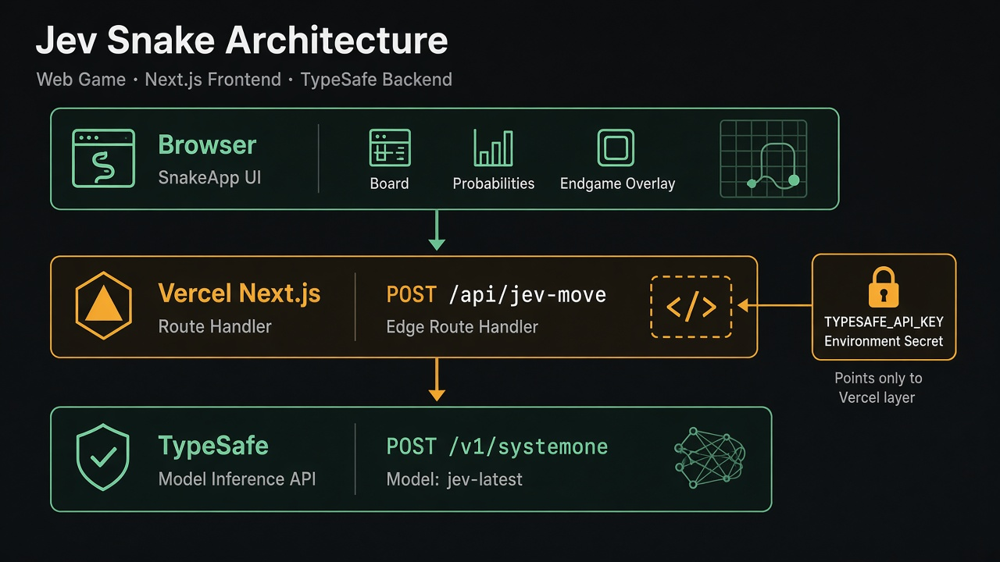
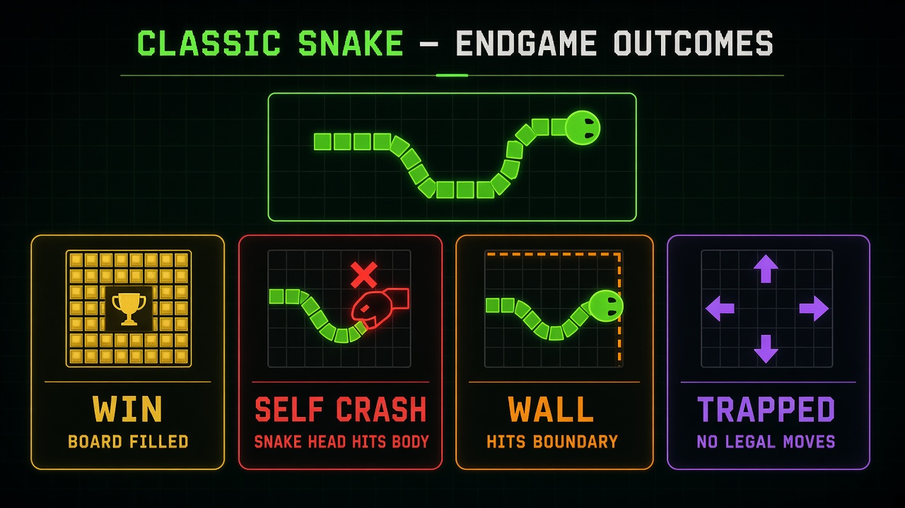
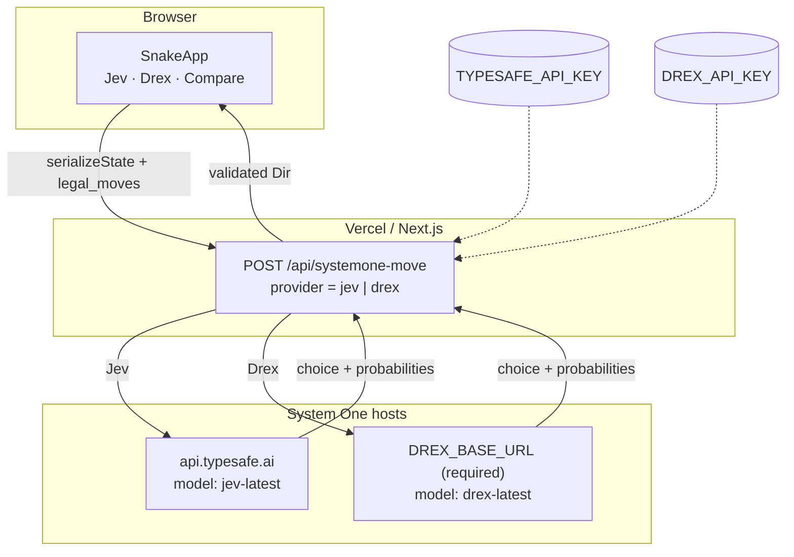
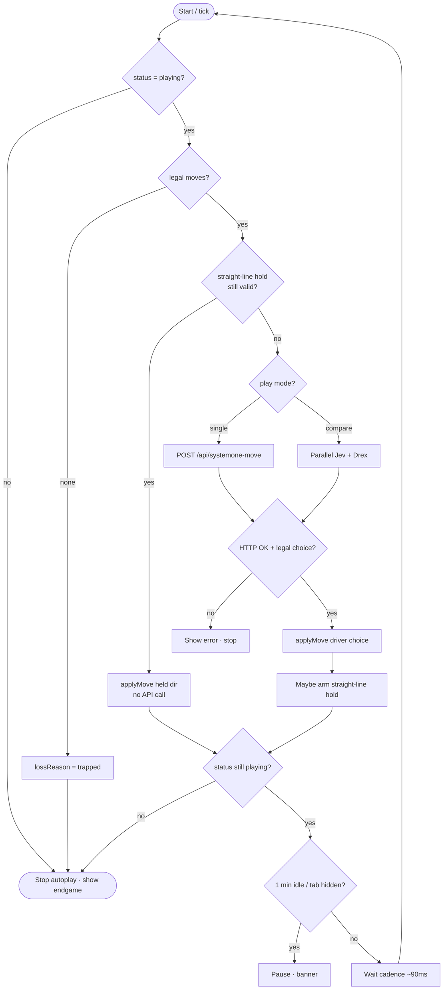
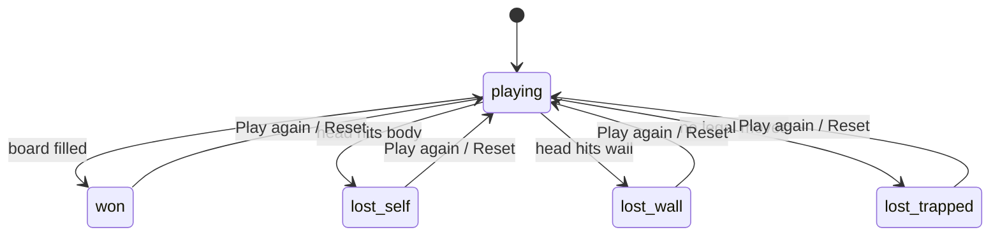

# Jev Snake (Web)

Snake autoplay where **every move decision** is a live System One Choice via `POST /v1/systemone`. Pick **Jev** (TypeSafe), **Drex**, or **Compare both** side by side. Safe straight-line holds may reuse the last legal direction without a new API call.



## Live

| | |
|---|---|
| Production | https://jev-snake-theta.vercel.app |
| Vercel project | https://vercel.com/apptonics-projects/jev-snake |
| GitHub | https://github.com/lalitsonawane/jev-snake |

## Win & lose (classic rules)

| Outcome | Rule |
|---------|------|
| **Win** | Snake length fills the board (`length === width × height`) |
| **Self crash** | Head moves onto a body cell (not the vacating tail) |
| **Wall** | Head leaves the board |
| **Trapped** | No legal moves remain |



## Models: Jev, Drex, Compare

| Mode | Behavior |
|------|----------|
| **Jev** | Autoplay driven by TypeSafe `jev-latest` |
| **Drex** | Autoplay driven by Drex `drex-latest` (wire-compatible System One) |
| **Compare** | Same `state` + `questions` sent to both in parallel; probabilities shown side by side. Pick which model's choice **drives** the snake (default Jev). |

Drex is wire-compatible with TypeSafe Jev (`noul` / `choice` / `score`). The TypeSafe SDK can talk to Drex by swapping three settings: API key, base URL, and default model (`drex-latest`). Some TypeSafe-shaped requests may return `422` from Drex on purpose (stricter validation).

Deep-link: `?mode=jev|drex|compare`.

## Session stats board

Beside the move-probability indicators, a **Session stats** panel shows live ops metrics (reset on Reset / model switch):

| Metric | Source |
|--------|--------|
| API calls · held · errors | Client tick accounting (`provider-stats`) |
| Last / avg latency | Round-trip ms to `/api/systemone-move` |
| Eval time | Upstream `evaluation_time_ms` when present |
| Tokens in/out | Upstream `usage` (`input_tokens` / `output_tokens` or prompt/completion aliases) |
| Last choice + confidence | Last / avg from probabilities |
| Agree-with-peer | Compare only — rate both returned the same choice |

Shared strip: score · length · steps · foods. In **Compare**, two columns (Jev \| Drex); the driving model gets a badge.

## Flow Sampler

Under the board / probs / stats region, **Flow Sampler** animates the System One application path (state → questions → answers/probabilities → move), Parallel Sampler–style:

- Sequential zigzag + serial clock (LLM-style contrast path)
- Parallel radial pulse + parallel clock (advances on each API answer)
- Metric tiles: latency, tokens, decisions/s, confidence grid (from driver tick + session stats)
- TYPE / TRACK / KERNEL console lines (choice, confidence, latency, tokens, model)

Idle loops a tasteful demo; live ticks drive the parallel pulse. `prefers-reduced-motion: reduce` freezes CSS motion.

## Architecture



## Autoplay tick flow



## Endgame state machine



## API routes

| Route | Body | Role |
|-------|------|------|
| `POST /api/systemone-move` | `{ provider: "jev" \| "drex", state, legal_moves, batch? }` | Unified server-only System One call |
| `POST /api/jev-move` | same shape (provider ignored) | Deprecated Jev-only alias |

JSON error statuses (never opaque HTML for config/upstream failures):

| Status | When |
|--------|------|
| `400` | Missing `state` / `legal_moves` |
| `502` | Upstream DNS/connect failure (JSON message + host hint) |
| `503` | Missing API key or missing/invalid base URL |
| `499` | Client abort (pause/reset) |

## Security

Keys are read **only** in the server Route Handler (`src/lib/systemone.ts` via `/api/systemone-move`). Never sent to the browser.

| Provider | API key env | Base URL env | Default base | Model |
|----------|-------------|--------------|--------------|-------|
| Jev | `TYPESAFE_API_KEY` (alias `TYPE_SAFE_API_KEY`) | `TYPESAFE_BASE_URL` (optional; alias `TYPE_SAFE_BASE_URL`) | `https://api.typesafe.ai` | `jev-latest` |
| Drex | `DREX_API_KEY` (**required**) | `DREX_BASE_URL` (**required**) | _(none — must set)_ | `drex-latest` |

Pause/reset aborts the browser `fetch` to `/api/systemone-move`; the route forwards `req.signal` so upstream calls are cancelled too.

> **Drex base URL:** There is no public default. `api.drex.ai` does not resolve (DNS `ENOTFOUND`). Set `DREX_BASE_URL` to your tenant’s System One root (`https://…` only — do **not** include `/v1/systemone`; the app appends it). Accidental `/v1/systemone` suffixes are stripped.

## Local

```bash
export TYPESAFE_API_KEY=...          # for Jev
export DREX_API_KEY=...              # for Drex / Compare
export DREX_BASE_URL=https://...     # required for Drex (your System One host)
# optional:
# export TYPESAFE_BASE_URL=https://api.typesafe.ai

npm install
npm run dev
```

```bash
npm test    # vitest
npm run build
```

## Vercel

GitHub-linked project: `lalitsonawane/jev-snake` → [apptonics-projects/jev-snake](https://vercel.com/apptonics-projects/jev-snake).

- Pushes to `main` → production
- Other branches → preview
- Env: `TYPESAFE_API_KEY`, `DREX_API_KEY`, and **`DREX_BASE_URL`** on Production + Preview (+ Development for `vercel env pull`)

## Docs map

| Doc | Purpose |
|-----|---------|
| [docs/architecture.md](docs/architecture.md) | Deep flows (Mermaid) |
| [docs/notion-sync.md](docs/notion-sync.md) | Repo ↔ Notion index |
| [docs/notes/2026-09-26-jev-drex-compare.md](docs/notes/2026-09-26-jev-drex-compare.md) | PR #8 — model picker + compare |
| [docs/notes/2026-09-26-drex-base-url-required.md](docs/notes/2026-09-26-drex-base-url-required.md) | PR #9 — required `DREX_BASE_URL` + JSON 502 |
| [docs/notes/2026-09-26-stats-board-compare.md](docs/notes/2026-09-26-stats-board-compare.md) | PR #10 — session stats board |
| [docs/notes/2026-09-27-flow-sampler-anim.md](docs/notes/2026-09-27-flow-sampler-anim.md) | PR #11 — Flow Sampler |
| [docs/notes/](docs/notes/) | All session / decision mirrors |
