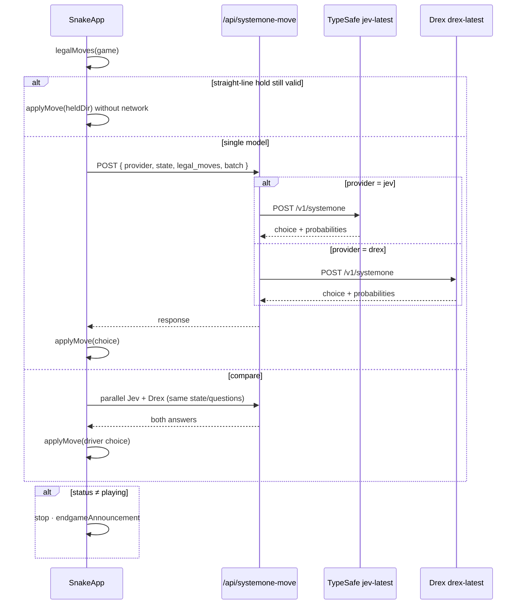
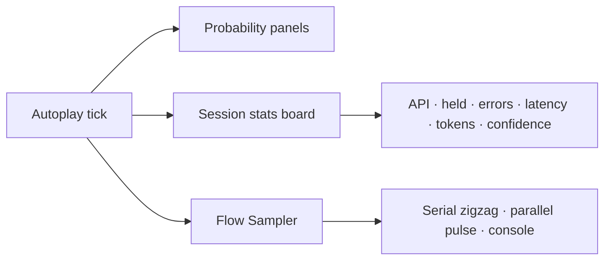
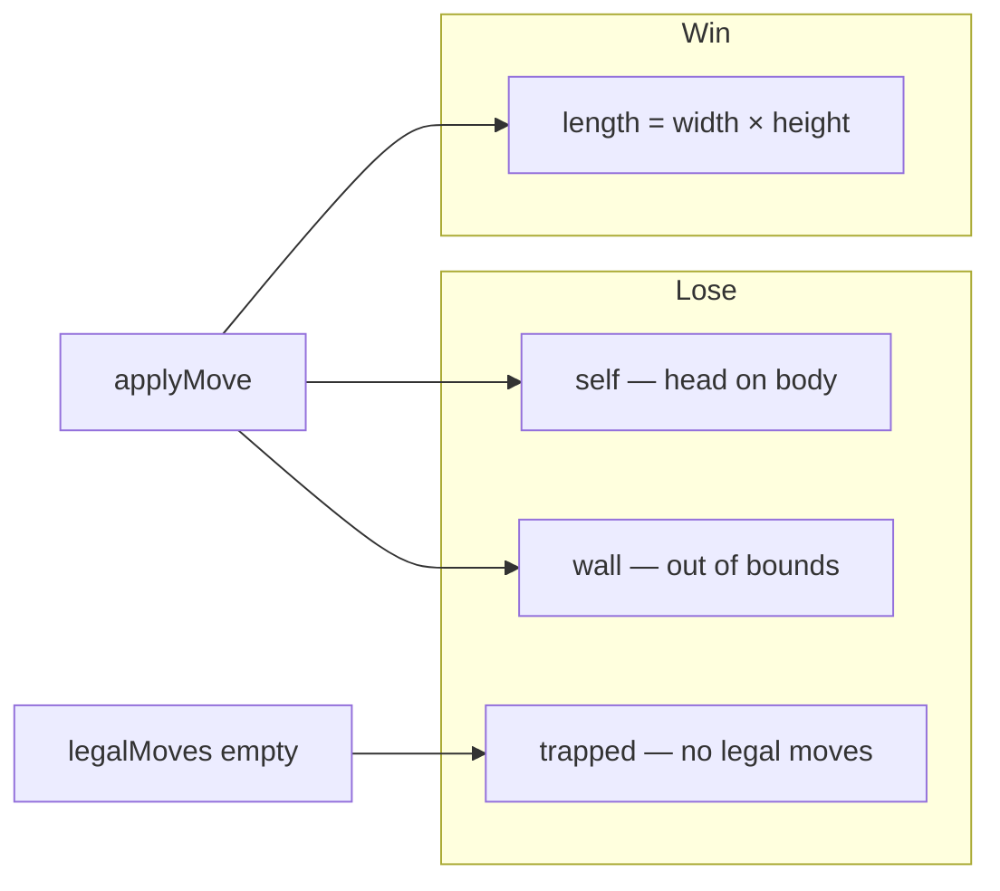
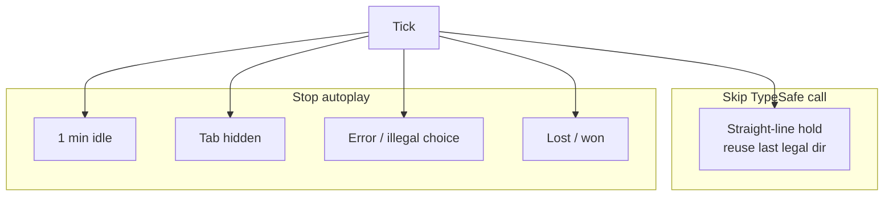
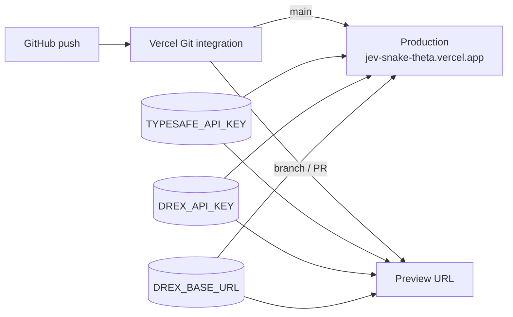

# Jev Snake — architecture

Repo mirror for the system design. Companion Notion page: https://app.notion.com/p/3e489f54d2c281fba90dda670039ba34 (also listed in [notion-sync.md](notion-sync.md)).

## Components

| Layer | Path | Role |
|-------|------|------|
| UI | `src/components/SnakeApp.tsx` | Autoplay loop, Jev/Drex/Compare, board, probs, StatsBoard, endgame |
| Flow UI | `src/components/FlowSampler.tsx` | Parallel Sampler–style application flow animation |
| Rules | `src/lib/snake.ts` | Moves, legal dirs, straight-line holds, win/lose, serializeState |
| Stats | `src/lib/provider-stats.ts` | Per-provider session metrics + compare agreement |
| Providers | `src/lib/systemone.ts` | Jev + Drex env, payload build, response shape, upstream error text |
| Route logic | `src/lib/systemone-route.ts` | Shared POST handler (503/502/499 JSON) |
| API | `src/app/api/systemone-move/route.ts` | Unified endpoint (`provider: jev \| drex`) |
| Alias | `src/app/api/jev-move/route.ts` | Deprecated Jev-only alias of systemone-move |
| Host | Vercel project `jev-snake` | GitHub deploys from `main` |

## Request path

## Env (server-only)

| Provider | Key | Base URL | Default base | Model |
|----------|-----|----------|--------------|-------|
| Jev | `TYPESAFE_API_KEY` (alias `TYPE_SAFE_API_KEY`) | `TYPESAFE_BASE_URL` (optional) | `https://api.typesafe.ai` | `jev-latest` |
| Drex | `DREX_API_KEY` | `DREX_BASE_URL` (**required**) | none (`api.drex.ai` does not resolve) | `drex-latest` |

`DREX_BASE_URL` must be an absolute `http(s)` System One **root**. Do not append `/v1/systemone` (stripped if present). Missing key/base → JSON `503`. Upstream DNS/connect fail → JSON `502` (not HTML 500).

## Session stats + Flow Sampler

- **Stats board** — beside probs; per-provider cumulative metrics; compare agreement rate; reset on Reset / mode switch. See [stats board note](notes/2026-09-26-stats-board-compare.md).
- **Flow Sampler** — under board/probs/stats; animates state → questions → answers → move; idle demo vs live pulse; respects `prefers-reduced-motion`. See [flow sampler note](notes/2026-09-27-flow-sampler-anim.md).

## Game rules

`endgameAnnouncement(game)` maps:

| `status` / `lossReason` | Title | Detail |
|-------------------------|-------|--------|
| `won` | Board cleared | Filled every cell |
| `lost` / `self` | Game over | Crashed into itself while maneuvering |
| `lost` / `wall` | Game over | Hit the wall |
| `lost` / `trapped` | Game over | No safe moves left |

## Token-saving behaviors

## Deploy pipeline

## Related notes

- [2026-09-26 Jev / Drex compare](notes/2026-09-26-jev-drex-compare.md) (PR #8)
- [2026-09-26 Drex base URL required](notes/2026-09-26-drex-base-url-required.md) (PR #9)
- [2026-09-26 Session stats board](notes/2026-09-26-stats-board-compare.md) (PR #10)
- [2026-09-27 Flow Sampler](notes/2026-09-27-flow-sampler-anim.md) (PR #11)
- [2026-10-11 Docs sync PRs #8–#11](notes/2026-10-11-docs-sync-pr8-11.md)
- [2026-09-23 Vercel GitHub link](notes/2026-09-23-vercel-github-link.md)
- [2026-09-23 Documentation refresh](notes/2026-09-23-docs-architecture.md)
- [2026-09-23 Straight-line hold](notes/2026-09-23-straight-line-hold.md)
- [2026-09-23 Idle auto-pause](notes/2026-09-23-idle-auto-pause.md)
- [2026-09-23 Endgame self-crash](notes/2026-09-23-endgame-self-crash.md)
- [2026-09-23 Cancel upstream on abort](notes/2026-09-23-cancel-upstream-jev-abort.md)
